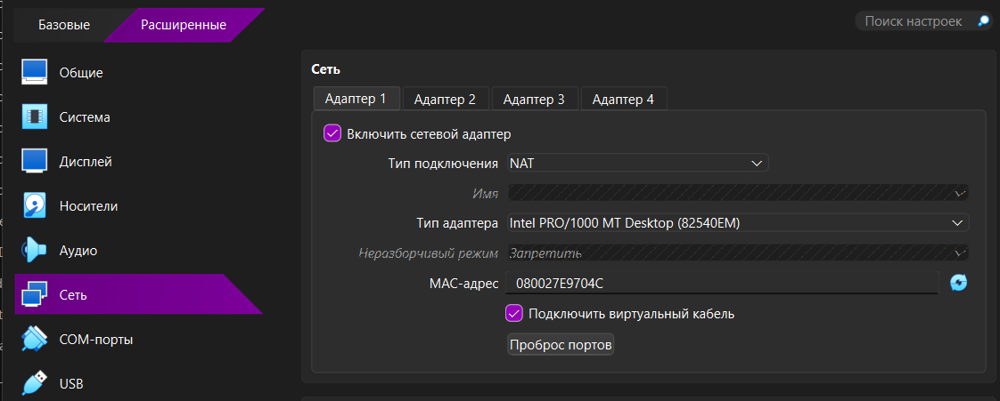
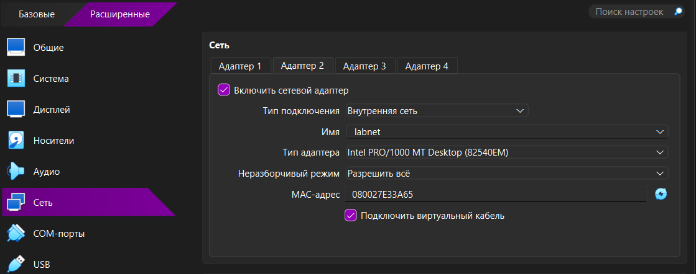
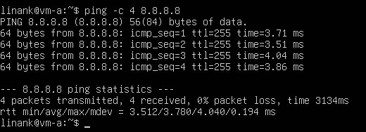
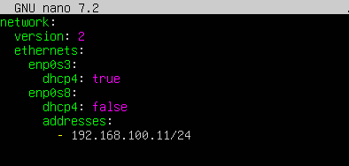
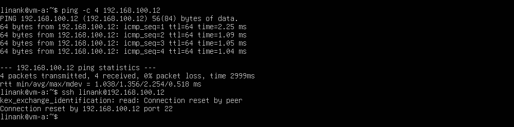
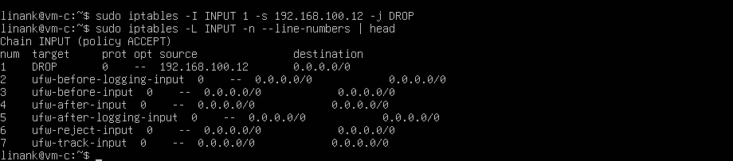
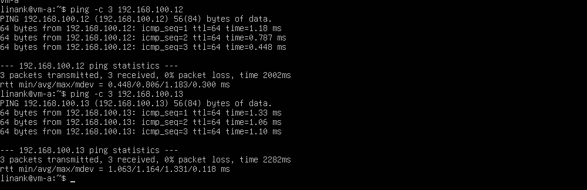
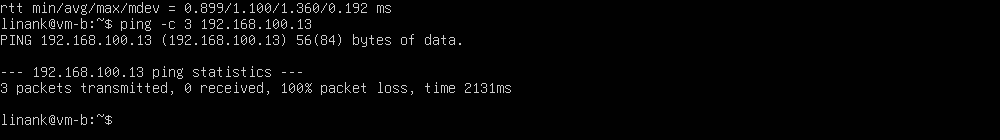
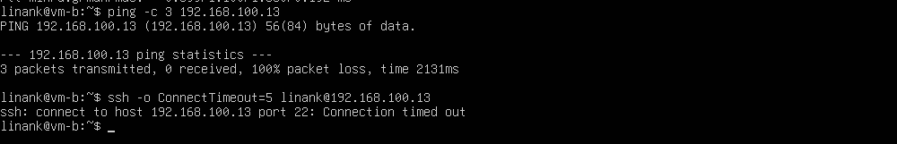

# Лабораторная работа №3. Виртуализация

**Выполнила:** Капленко Алина Денисовна, K3361

## 1. Цель работы

Настроить три виртуальные машины Ubuntu в VirtualBox, обеспечить выход в интернет и сетевое взаимодействие между ними, ограничить доступ с машины Б на машину В.

## 2. Схема сети

```
            Интернет
               │
   ┌───────────┼───────────┐
   │ NAT       │ NAT       │ NAT
 ┌─┴─┐       ┌─┴─┐       ┌─┴─┐
 │ A │       │ Б │       │ В │
 └─┬─┘       └─┬─┘       └─┬─┘
   └───────────┴───────────┘
     Внутренняя сеть labnet 192.168.100.0/24
     A = .11    Б = .12    В = .13
```

| Машина | Hostname | NAT (интернет) | Внутренняя сеть |
|---|---|---|---|
| А | vm-a | 10.0.2.15 (DHCP) | 192.168.100.11/24 |
| Б | vm-b | 10.0.2.15 (DHCP) | 192.168.100.12/24 |
| В | vm-c | 10.0.2.15 (DHCP) | 192.168.100.13/24 |

## 3. Подготовка

- Включена виртуализация в BIOS (по умолчанию работает на ноутбуке).
- Установлен VirtualBox версии 7.2.6.
- Скачан Ubuntu Server 24.04 LTS (ubuntu-24.04.3-live-server-amd64.iso).

## 4. Машина А

Параметры: 2 ГБ ОЗУ, 2 CPU, диск 15 ГБ (VDI, динамический).

Сеть: Адаптер 1 — NAT, Адаптер 2 — Внутренняя сеть `labnet`.




Ubuntu Server установлена вручную: имя сервера `vm-a`, установлен OpenSSH server.

### 4.1 Проверка доступа в интернет

```bash
ip -br a
ping -c 4 8.8.8.8
ping -c 4 ya.ru
```



Потерь пакетов нет, DNS работает.

### 4.2 Статический IP во внутренней сети

Файл `/etc/netplan/50-cloud-init.yaml`:



```bash
sudo chmod 600 /etc/netplan/50-cloud-init.yaml
sudo netplan apply
```

## 5. Машина Б и доступ А → Б

Машина создана клонированием VM-A с новыми MAC-адресами. После запуска:

```bash
sudo hostnamectl set-hostname vm-b
sudo rm /etc/machine-id
sudo systemd-machine-id-setup
sudo nano /etc/netplan/50-cloud-init.yaml   # адрес 192.168.100.12/24
sudo netplan apply
sudo rm /etc/ssh/ssh_host_*
sudo ssh-keygen -A
sudo systemctl restart ssh
sudo reboot
```

Проверка с машины А:

```bash
ping -c 4 192.168.100.12
ssh linank@192.168.100.12
hostname
```



## 6. Машина В

Создана клонированием, настроена аналогично Б: hostname `vm-c`, адрес `192.168.100.13/24`, пересозданы `machine-id` и SSH-ключи.

## 7. Запрет доступа Б → В

На машине В добавлено правило, блокирующее весь входящий трафик с адреса Б (`192.168.100.12`):

```bash
sudo iptables -I INPUT 1 -s 192.168.100.12 -j DROP
sudo iptables -L INPUT -n --line-numbers
```



Доступ с машины А (`192.168.100.11`) не ограничивался.

## 8. Итоговая проверка

На одном экране показаны терминалы всех трёх машин:

- с А доступны Б и В (ping и ssh проходят);
- с Б машина В недоступна (100% packet loss, ssh — timeout).





## 9. Возникшие трудности

- Ошибка `vmwgfx` при загрузке Ubuntu: пришлось сменить графический контроллер на VBoxSVGA.
- `Connection reset by peer` при ssh на Б: после удаления host-ключей их нужно пересоздать (`sudo ssh-keygen -A`).
- `ufw deny from` не блокировал ping: ICMP разрешён в `before.rules`, поэтому использовано правило iptables.

## 10. Вывод

Настроены три виртуальные машины в VirtualBox. Адаптер NAT обеспечивает выход в интернет, внутренняя сеть `labnet` — связь между машинами. Доступ с Б на В запрещён фильтрацией на машине В, доступ с А ко всем машинам сохранён.
